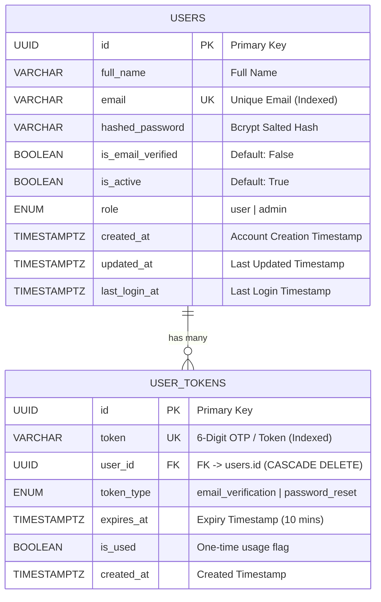

# 🔐 Production-Ready FastAPI JWT Authentication System

A secure, scalable, and modular **Authentication & Authorization REST API** built with **FastAPI**, **SQLAlchemy (Async)**, and **JWT (JSON Web Tokens)**. Features encrypted password storage, 6-digit OTP email verification, password reset flows, role-based access control, and complete entity relationship modeling.

---

## 🌟 Key Features

- 🔑 **JWT-Based Authentication**: Issues short-lived access tokens (`30m`) and secure long-lived refresh tokens (`7d`) with rotation.
- 🛡️ **Role-Based Access Control (RBAC)**: Supports `user` and `admin` roles with hierarchical dependency injection (`get_current_user`, `get_verified_user`, `require_admin`).
- 🔒 **Native Bcrypt Hashing**: Passwords salted and hashed with bcrypt (no plain-text storage).
- 📬 **6-Digit OTP Email Verification**: Two-step account activation via email OTPs (works in Dev Simulator & Gmail SMTP).
- 🔄 **Password Reset Flow**: Secure OTP-based forgotten password recovery.
- ⚡ **Asynchronous Architecture**: Fully async database interactions using SQLAlchemy 2.0 with SQLite / PostgreSQL support.
- 📑 **Interactive API Docs**: Built-in Swagger UI (`/docs`) and ReDoc (`/redoc`) with OAuth2 Bearer token authentication.

---

## 🗃️ Entity Relationship (ER) Diagram



---

## 🚀 Tech Stack

- **Language:** Python 3.12+
- **Framework:** FastAPI
- **Server:** Uvicorn (ASGI)
- **Database / ORM:** SQLAlchemy 2.0 (Async) + aiosqlite / asyncpg
- **Security & Crypto:** native `bcrypt`, `python-jose` (HS256)
- **Validation:** Pydantic v2 (email validator)
- **Email:** `aiosmtplib` (Gmail SMTP / Console Dev Fallback)

---

## 📁 Project Structure

```text
Authentication/
├── app/
│   ├── config.py         # Environment-based app configuration
│   ├── database.py       # Async database engine & session dependency
│   ├── dependencies.py   # Auth & role-based route guards
│   ├── email_service.py  # Email dispatch & console OTP simulator
│   ├── main.py           # FastAPI entrypoint, CORS & Lifespan
│   ├── models.py         # SQLAlchemy ORM models (User, UserToken)
│   ├── schemas.py        # Pydantic v2 request/response schemas
│   ├── security.py       # Bcrypt password hashing & JWT handlers
│   └── routers/
│       ├── auth.py       # /auth/ endpoints (Register, Login, OTP, Reset)
│       └── users.py      # /users/ endpoints (Protected user & admin routes)
├── .env.example          # Sample environment variables
├── requirements.txt      # Python dependencies
└── README.md
```

---

## 🛠️ Getting Started

### 1. Clone the repository
```bash
git clone https://github.com/your-username/fastapi-jwt-auth.git
cd fastapi-jwt-auth
```

### 2. Set up virtual environment
```bash
python -m venv venv

# Windows
.\venv\Scripts\activate

# Linux / macOS
source venv/bin/activate
```

### 3. Install dependencies
```bash
pip install -r requirements.txt
```

### 4. Configure Environment Variables
Copy `.env.example` to `.env`:
```bash
copy .env.example .env
```
Default `.env` configuration uses SQLite (`sqlite+aiosqlite:///./auth.db`) with zero external database configuration required.

### 5. Run the server
```bash
uvicorn app.main:app --reload
```
The server will start at `http://127.0.0.1:8000`.

---

## 📖 API Documentation & Endpoints

Open **`http://localhost:8000/docs`** for interactive Swagger UI testing.

| Category | Method | Endpoint | Description | Auth Required |
|---|---|---|---|---|
| **Auth** | `POST` | `/auth/register` | Register new user & dispatch 6-digit OTP | ❌ |
| **Auth** | `POST` | `/auth/verify-otp` | Verify email with 6-digit OTP | ❌ |
| **Auth** | `POST` | `/auth/resend-otp` | Resend verification OTP | ❌ |
| **Auth** | `POST` | `/auth/login` | Login with credentials → returns JWT access & refresh tokens | ❌ |
| **Auth** | `POST` | `/auth/refresh` | Refresh expired access token | ❌ |
| **Auth** | `POST` | `/auth/forgot-password` | Request password reset OTP | ❌ |
| **Auth** | `POST` | `/auth/reset-password-otp` | Reset password using 6-digit OTP | ❌ |
| **Auth** | `POST` | `/auth/logout` | Invalidate session client-side | 🔒 Bearer |
| **User** | `GET` | `/users/me` | Fetch logged-in user profile | 🔒 Bearer |
| **User** | `PATCH` | `/users/me` | Update profile information | 🔒 Bearer |
| **User** | `POST` | `/users/me/change-password` | Change password while authenticated | 🔒 Bearer + Verified |
| **Admin** | `GET` | `/users/` | List all users (paginated) | 👑 Admin Only |
| **Admin** | `DELETE`| `/users/{id}` | Delete a user by ID | 👑 Admin Only |

---

## 🔒 Security Highlights

- **Salted Bcrypt Hashes:** Defends against rainbow table attacks.
- **Timing Attack Mitigation:** Authentication executes password verification even for non-existent users to eliminate timing side-channels.
- **User Enumeration Prevention:** Forgot password API returns identical responses whether an account exists or not.
- **Token Invalidation:** One-time OTPs are flagged `is_used = True` and bound to 10-minute expiry windows.

---

## 📄 License
This project is licensed under the MIT License.
